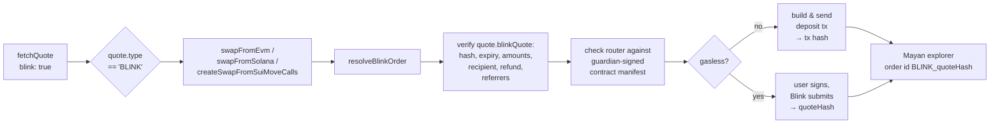
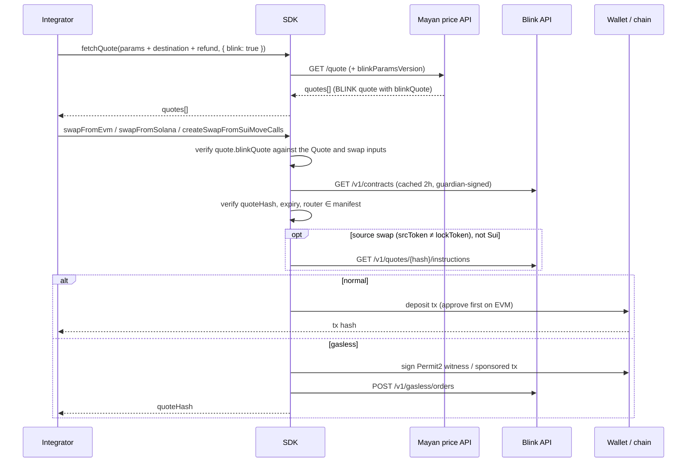
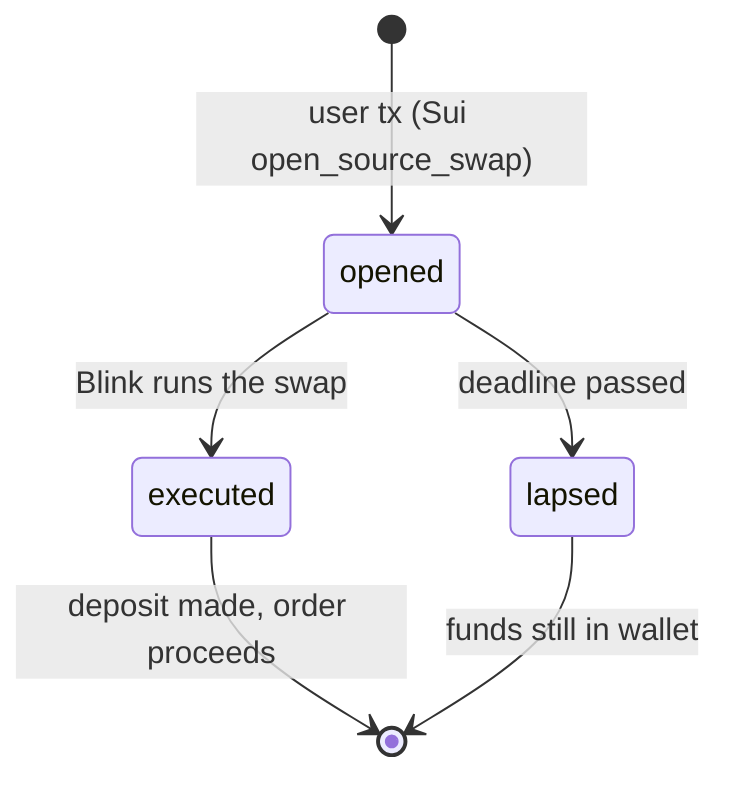

# Blink — integrator notes

Blink is Mayan's inventory-backed route. From the SDK's point of view it is one more
`Quote.type` (`'BLINK'`) next to `SWIFT`, `MCTP`, `FAST_MCTP`, `WH` and `MONO_CHAIN`.
You do **not** call anything in `src/blink/` for the happy path: `fetchQuote` returns
BLINK quotes by default, and `swapFromEvm` / `swapFromSolana` / `createSwapFromSuiMoveCalls`
recognise them and build the right deposit.

This note is about what you need to know _at the SDK level_. It does not cover how
Blink settles on the destination chain.

---

## 1. Minimal integration

```ts
import {
	fetchQuote,
	swapFromEvm,
	ChainReferrers,
} from '@mayanfinance/swap-sdk';

const referrers: ChainReferrers = {
	evm: [{ address: REF, bps: 20 }],
	solana: null,
	sui: null,
};

const quotes = await fetchQuote(
	{
		amountIn64: '100000000',
		fromToken: USDC_BASE,
		fromChain: 'base',
		toToken: USDC_ARB,
		toChain: 'arbitrum',
		slippageBps: 'auto',
		destinationAddress: recipient, // required for BLINK, see §3
		swapperAddress: swapper, // required for BLINK, see §3
	},
	{ referrers } // blink: true is the default; pass blink: false to opt out
);

const quote = quotes.find((q) => q.type === 'BLINK');

const result = await swapFromEvm(
	quote,
	swapper,
	recipient,
	referrers,
	signer,
	null, // permit
	null, // overrides
	null, // payload (not supported for BLINK)
	{ includeAllowanceTx: true }
);
// result: TransactionResponse for a normal order, quoteHash string for a gasless one
```

Solana and Sui use the same `swapFromSolana` / `createSwapFromSuiMoveCalls` calls you
already use for other quote types. The only Blink-specific entry points you may ever
need are listed in §9.

---

## 2. What the SDK does for you



Everything inside `resolveBlinkOrder` is a safety check on data that came from the
network. If any check fails the swap throws **before** anything is signed or sent.

---

## 3. The quote must carry the order

A BLINK order is bound to a recipient and a refund address, and Mayan only issues one
when `fetchQuote` gets the recipient and the wallet that signs the swap. The SDK never
fetches a quote on its own:

| You pass to `fetchQuote`                      | What you get                                                                                                        | What happens at swap time                                                                               |
| --------------------------------------------- | ------------------------------------------------------------------------------------------------------------------- | ------------------------------------------------------------------------------------------------------- |
| `destinationAddress` **and** `swapperAddress` | `quote.blinkQuote` holds the Blink order; the refund address is `refundAddress`, or the swapper when it is left out | SDK verifies it and builds the deposit from it. No extra round trip.                                    |
| `destinationAddress` and only `refundAddress` | The order, built for the refund address as the swapper                                                              | Fine when the refund address is the swapper; a Solana source swap refunding elsewhere is refused (§10). |
| neither                                       | A price preview. `quote.blinkQuote` is absent                                                                       | The swap throws `Blink quote carries no order`. Re-fetch the quote with the addresses.                  |

So in a UI funnel, fetch the quote you show on the confirmation screen with the connected
wallet as `swapperAddress` and the recipient as `destinationAddress` (plus `refundAddress`
to refund elsewhere), and hand that exact `Quote` object to the swap.
`hasBlinkQuoteHash(quote)` tells you whether a quote is swappable.

The SDK validates the embedded order against the `Quote` and the swap inputs (chains,
`effectiveAmountIn64`, recipient = `destinationAddress`, refund = swapper, `gasless`
flag, `minReceivedBaseUnits`, referrers). A mismatch throws, and the fix is always to
re-fetch the quote with the right inputs.

**Quotes expire 30 minutes after issuance** (`expiresAt`), and the price is fixed at
issuance; it does not follow the market. Re-quote if the user has been sitting on a
confirmation screen. Past `expiresAt` the SDK refuses to build the deposit
(`Blink quote expired, request a new quote`); re-run `fetchQuote`.



---

## 4. Per-chain cheat sheet

| Source chain | Entry point                                           | Normal order                                                                         | Gasless order                                                                                                                  |
| ------------ | ----------------------------------------------------- | ------------------------------------------------------------------------------------ | ------------------------------------------------------------------------------------------------------------------------------ |
| EVM          | `swapFromEvm` / `getSwapFromEvmTxPayload`             | Tx **to the Blink deposit contracts** (escrow or router, §5; not the Mayan forwarder). Native token goes as `value`.  | User signs one Permit2 witness; without a Permit2 allowance pass the token permit from `signEvmSwapPermit` (§7). Returns `quoteHash`. ERC20 input only. |
| Solana       | `swapFromSolana` / `createSwapFromSolanaInstructions` | Deposit (or swap+deposit) instructions. Priority fee fetched from Blink.             | User signs a tx whose fee payer is the Blink sponsor. Returns `{ signature: quoteHash, serializedTrx: null }`. No source swap. |
| Sui          | `createSwapFromSuiMoveCalls`                          | Move call `blink::deposit`, or `blink::open_source_swap` for a source swap (see §6). | **Call `swapBlinkGaslessFromSui` directly** with a `signTransaction` callback. Returns `quoteHash`.                            |

Custom `payload` is rejected for BLINK. `refundAddress` is honoured (§10); the older
`swiftRefundAddress` is ignored. Jito bundles are skipped for any gasless quote.

A BLINK quote with `fromChain === toChain` is a **same-chain swap** (EVM only): the
router swaps and pays the recipient inside the deposit transaction, so there is no
gasless path, no gas drop, and the order goes straight to `fulfilled`.

---

## 5. EVM approvals

Blink deposits bypass the Mayan forwarder, so the usual forwarder allowance does not
help. Blink runs **two deposit contracts per chain**, and the quote names only one of them:

- `order.quote.routerAddress` (the same value as `orderParams.routerAddress`) is the
  **escrow**: it takes plain transfers, `depositToken` and `depositNative`.
- `order.contracts.router`, from the guardian-signed manifest, is the **router**: it has the
  permit variants (`depositTokenWithPermit`, …) and the source-swap entry points.

The approval helpers in `src/evm/evmApproval.ts` (§7) know all of this and work for every
quote type, so a UI can use them without branching on Blink. Underneath,
`getBlinkEvmDepositSpender(order, permit)` returns the contract that pulls the tokens for the
deposit the SDK will build, or `null` when nothing needs approving. Options, in order of
convenience:

1. `swapFromEvm(..., { includeAllowanceTx: true })` — the SDK bundles the approval
   (atomic batch; the wallet must support it).
2. Call `resolveBlinkOrder(quote, swapper, recipient, referrers)` yourself and approve
   `getBlinkEvmDepositSpender(order, false)` for `expectedAmountIn`. Without a source swap
   that is the escrow, `order.quote.routerAddress`.
3. Pass a `permit` signed with `getBlinkEvmDepositSpender(order, true)` as spender, covering
   the full amount. Without a source swap that is the **manifest router**,
   `order.contracts.router`, **not** `order.quote.routerAddress`: a permit for the escrow
   makes `depositTokenWithPermit` revert with `TransferFailed()`, because the router swallows
   the failed `permit` and the `transferFrom` that follows has no allowance.

Two cases need no approval at all:

- **Direct transfer.** When `order.quote.directTransfer` is set (ERC20, cross-chain,
  no source swap) the SDK sends a plain `transfer(escrow, amount)` with the quote hash
  appended to the calldata. `includeAllowanceTx` is skipped automatically. Blink reads
  the hash from the transaction's own calldata, so a **smart-contract wallet or any
  batching layer hides it and the deposit is not attributed**. The SDK takes this path
  whenever the quote allows it; the only way to force the router path is to pass a
  `permit`.
- **Native token.** Sent as `value`.

Gas: the `estimateQuoteRequiredGas*` helpers return `0` for gasless BLINK;
`estimateQuoteRequiredGas` adds a 10% margin for normal BLINK orders.

---

## 6. Source swaps

If the order's `srcToken` differs from its `lockToken`, the deposit first swaps on the
source chain through an aggregator. `needsBlinkSourceSwap(order.quote.orderParams)` tells
you. For the integrator this is transparent **except**:

- **Sui**: the user's tx only _opens_ the source swap; Blink executes it afterwards
  (up to 3 attempts inside a 5-minute window). Track the execution on the Mayan
  explorer with the quote hash. If the intent lapses the coins stay in the user's own
  Sui address balance.
  If you prefetch the order, pass it via `ComposableSuiMoveCallsOptions.blinkOrder`
  so the same order is used for the Move calls.
- **Solana gasless**: source swaps are rejected (`Gasless Blink swap deposits are
unavailable on solana`). Fall back to a non-gasless quote.



---

## 7. Gasless

Request it with `{ gasless: true }` in `QuoteOptions`; the quote comes back with
`quote.gasless === true`. The normal swap functions detect this and route to the
gasless path (EVM, Solana); on Sui call `swapBlinkGaslessFromSui`.

- Only offered for cross-chain orders with a non-native source token, on chains whose
  `getBlinkChains()` entry reports `gasless: true`.
- The call returns as soon as Blink has accepted the submission, with the **quote
  hash**, not a tx hash. Blink broadcasts the deposit itself: on EVM the submission sits
  in `pending` while gas is above what the quote priced and only turns `failed` once
  the Permit2 deadline passes (see below).
- Track the submission on the Mayan explorer by `BLINK_<quoteHash>`, as for a gasless
  Swift order. `rejected` means the deposit needed more gas than the quote covered;
  `failed` is any other failure. Request a new quote in both cases.
- Submission is idempotent per quote hash. Re-submitting a hash that already failed or
  was rejected throws with Blink's `error` message.
- **Two wallet pop-ups at most, never in the same step.** The swap signs one message,
  the Permit2 transfer bound to the quote hash. Permit2 itself needs an allowance on the
  token, given once per token and wallet: `signEvmSwapPermit(quote, signer)` signs the
  token's EIP-2612 permit for Permit2 (unlimited, no gas), which you pass to `swapFromEvm`
  as `permit`; Blink's router runs it with the deposit. A token without a permit (USDT on
  Ethereum) needs one approve transaction from `getEvmSwapApproveTxs` instead, the only
  gas the user pays. `isEvmSwapAllowanceEnough(quote, owner, provider, permit)` tells
  whether that step is still needed; without the allowance or the permit the swap throws.
- The order's Permit2 deadline is the permit's deadline when one is passed, since the
  router runs both with the same one; otherwise 30 minutes from the swap.
- **Signing elsewhere** (a backend such as tx-builder, a non-ethers wallet): each chain has
  a builder that returns what to sign and a quote hash, and `submitBlinkGaslessOrder` sends
  the signed result. `swapBlinkGaslessFrom*` are these builders plus a signer.

  | Chain  | Build                                   | Submit (`submitBlinkGaslessOrder`)                   |
  | ------ | --------------------------------------- | ---------------------------------------------------- |
  | EVM    | `getBlinkGaslessFromEvmParams` → `typedData` + `order` | `{ quoteHash, evm: { ...order, signature } }` |
  | Solana | `getBlinkGaslessFromSolanaTransaction` → `transaction` | `{ quoteHash, svm: { txBase64 } }` (signed, sponsor slot empty) |
  | Sui    | `getBlinkGaslessFromSuiTransaction` → `transaction`    | `{ quoteHash, sui: { txBase64, signature } }`  |

  The approval step works the same way: `getEvmSwapPermitParams` returns the token permit as
  typed data instead of signing it.
- The quote hash doubles as the explorer order id: `BLINK_<quoteHash>` on Mayan, or
  `https://hular.dev/explorer/<quoteHash>` on Blink's own explorer.

---

## 8. Tracking an order

Track orders through Mayan's explorer API with the order id `BLINK_<quoteHash>`, the
same way as a gasless Swift order. The SDK has no Blink status endpoints of its own.
Blink's `state` values, terminal ones in bold:

| `state`                                                          | Meaning                                                                                       |
| ---------------------------------------------------------------- | --------------------------------------------------------------------------------------------- |
| `created`, `awaiting_finality`, `ready_to_fulfill`, `fulfilling` | In progress. `awaiting_finality` is the source-chain confirmation wait.                       |
| **`fulfilled`**                                                  | Recipient has the funds.                                                                      |
| `pending_refund`, `refunding`, `awaiting_refund_window`          | Refund in progress. Treat `awaiting_refund_window` as pending, not failed.                    |
| **`refunded`**                                                   | Deposit returned to the refund address, in `lockToken`, minus the committed source-side fees. |
| `review`                                                         | Operator is looking. Still pending; funds are safe.                                           |
| **`refund_skipped`**, **`support`**                              | Needs support. Funds remain in escrow. Say so plainly and show the quote hash.                |

- `dstTxHash` is set when the fulfillment is **submitted**, not confirmed. Only
  `state === 'fulfilled'` means the funds arrived.
- This SDK has no `isTerminalState` helper; the terminal set is `fulfilled`,
  `refunded`, `refund_skipped`, `support`.
- `order.quote.fulfillEtaSecs` (median deposit-to-fill time for the pair) is a good
  ETA to show while pending.

The Blink API calls live in `src/api.ts` next to the other Mayan endpoints and throw
the API's `{ code, message }` body on a non-2xx status, like those do:

| Function                     | Returns                                                                |
| ---------------------------- | ---------------------------------------------------------------------- |
| `getBlinkChains()`           | supported chains, native symbol/decimals, `maxGasDrop`, `gasless` flag |
| `getBlinkContracts()`        | raw guardian-signed manifest (you normally never need it)              |
| `getBlinkPriorityFee(chain)` | Solana compute-unit price Blink recommends                             |

---

## 9. Public surface you might touch

| Export                                       | When                                                                               |
| -------------------------------------------- | ---------------------------------------------------------------------------------- |
| `hasBlinkQuoteHash(quote)`                   | Is this quote swappable, i.e. fetched with the addresses of §3?                    |
| `resolveBlinkOrder(...)`                       | Prefetch the verified `BlinkOrder` (EVM approval target, Sui `blinkOrder` option). |
| `getBlinkEvmDepositSpender(order, permit)`   | The approval or permit spender of the deposit the SDK will build (§5); `null` when none is needed. |
| `BlinkOrder`                                 | `{ quote: BlinkQuote, swap?: BlinkSwapInstructions, contracts }`.                  |
| `isBlinkQuoteExpired(order.quote)`           | Decide whether to re-quote before sending.                                         |
| `needsBlinkSourceSwap(order.quote.orderParams)` | Branch on source-swap behaviour (§6).                                              |
| `swapBlinkGaslessFromSui(...)`               | Gasless on Sui (no automatic routing there).                                       |
| `getEvmSwapApproval` / `isEvmSwapAllowanceEnough` / `getEvmSwapPermitParams` / `signEvmSwapPermit` / `getEvmSwapApproveTxs` | The approval step before an EVM swap, for any quote type (§7). |
| `getBlinkGaslessFromEvmParams` / `getBlinkGaslessFromSolanaTransaction` / `getBlinkGaslessFromSuiTransaction` | Gasless orders signed outside the SDK (§7). |
| `loadBlinkOrder(quote)`                      | `resolveBlinkOrder` without the swap-input checks or the swap route: enough to know what to approve, and calls no Blink endpoint but the cached manifest. |
| `BlinkUnregisteredAddressError`              | Router/escrow not in the signed manifest. Treat as "do not proceed".               |

Everything else in `src/blink/` (hash encoding, manifest verification, decoders) is
internal plumbing that the swap functions run for you.

---

## 10. Gotchas

- **Same referrers both times.** Pass the same `referrers` to `fetchQuote` and as
  `referrerAddresses` to the swap, keyed by the **source** chain VM. Blink pays referrers
  on the source chain. A bps mismatch throws `Referrer bps mismatch`.
- **Refund address defaults to the swapper.** The SDK checks the embedded order's refund
  address against the `refundAddress` swap option, or the swapper when none is passed,
  and throws otherwise. To refund elsewhere, fetch the quote with that `refundAddress`
  and the signing wallet as `swapperAddress`, and pass the same `refundAddress` in the swap
  options; this works on every chain. Without `swapperAddress` Blink builds a Solana source
  swap for the refund address, and the SDK refuses it (`token account rent is paid by …,
  not the depositor`). On Sui a
  prefetched order passed via `blinkOrder` is used as is, and must agree with
  `refundAddress` when both are given.
- **Zero addresses are rejected** for destination and refund.
- **Guardian set.** The quote's `guardianSetIndex` must match the current manifest.
  A stale cached manifest is refreshed automatically; a real mismatch throws.
- **Params version.** The SDK sends `blinkParamsVersion` with every quote request and
  refuses orders newer than `BLINK_SUPPORTED_PARAMS_VERSION`. Upgrade the SDK if you
  see `Blink quote uses params version N`.
- **Gas drop** (`gasDrop` on the quote request) is delivered with the fulfillment and
  capped per destination chain (`getBlinkChains()[].maxGasDrop`). It is never delivered
  or charged on a refund.
- **Keyless Blink API calls.** The SDK's direct calls to Blink (contracts, swap
  instructions, priority fee, gasless submit) carry no API key, so they share the
  keyless budget of 500 points per minute per IP. A server submitting many orders from
  one IP can get a 429 with gRPC code 8 thrown; back off, the budget refills
  continuously. Quotes themselves go through Mayan's price API, not straight to Blink.
- **Referrer payouts are vouchers, not per-swap transfers.** Blink accrues referrer
  fees off-chain per fulfilled order and pays them as signed vouchers claimed by the
  partner that requested the quote from Blink (Mayan's backend, for this SDK). Confirm
  the payout process with Mayan before promising referrers anything.
- **Operator-run.** One operator holds the inventory and custody of deposits in flight.
  It is not a trust-minimised bridge; be accurate about that with your users.
- **No sandbox.** Every Blink endpoint is mainnet. Staging is a separate host; the base
  URL lives in `addresses.BLINK_API_URL`.
