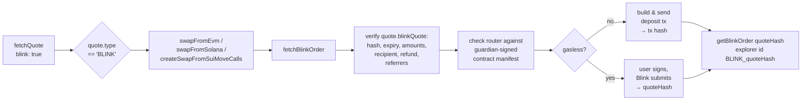
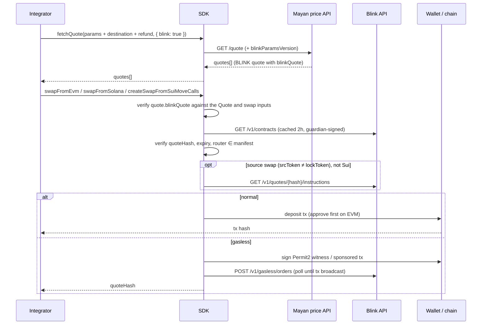
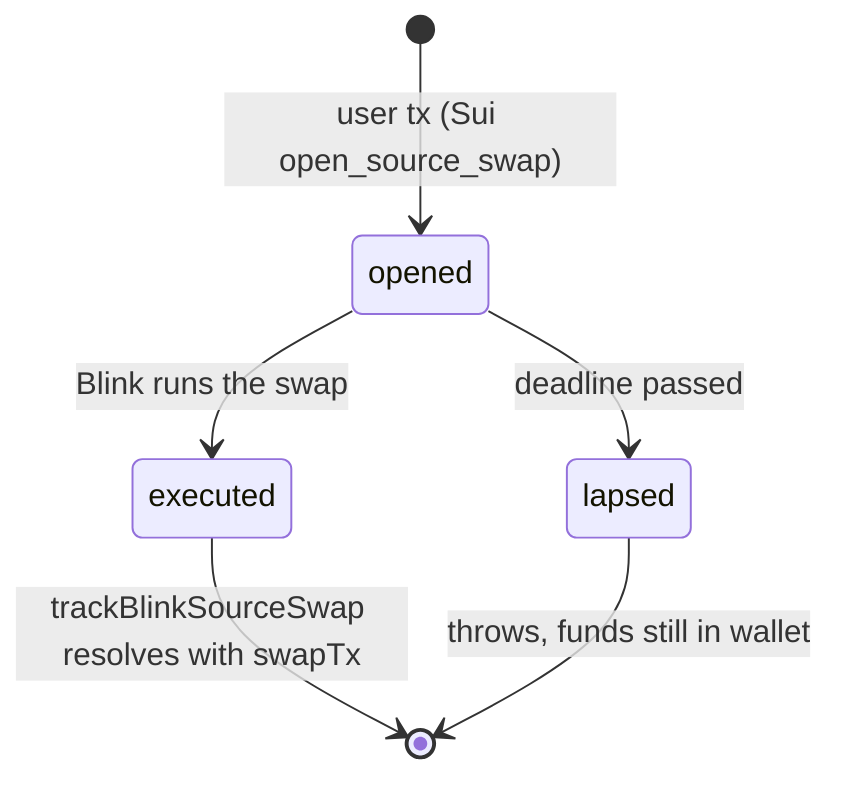

# Blink — integrator notes

Blink is Mayan's inventory-backed route. From the SDK's point of view it is one more
`Quote.type` (`'BLINK'`) next to `SWIFT`, `MCTP`, `FAST_MCTP`, `WH` and `MONO_CHAIN`.
You do **not** call anything in `src/blink/` for the happy path: `fetchQuote` returns
BLINK quotes by default, and `swapFromEvm` / `swapFromSolana` / `createSwapFromSuiMoveCalls`
recognise them and build the right deposit.

This note is about what you need to know _at the SDK level_. It does not cover how
Blink settles on the destination chain.

---

## 1. Minimal integration

```ts
import {
	fetchQuote,
	swapFromEvm,
	ChainReferrers,
} from '@mayanfinance/swap-sdk';

const referrers: ChainReferrers = {
	evm: [{ address: REF, bps: 20 }],
	solana: null,
	sui: null,
};

const quotes = await fetchQuote(
	{
		amountIn64: '100000000',
		fromToken: USDC_BASE,
		fromChain: 'base',
		toToken: USDC_ARB,
		toChain: 'arbitrum',
		slippageBps: 'auto',
		destinationAddress: recipient, // required for BLINK, see §3
		refundAddress: swapper, // required for BLINK, see §3
	},
	{ referrers } // blink: true is the default; pass blink: false to opt out
);

const quote = quotes.find((q) => q.type === 'BLINK');

const result = await swapFromEvm(
	quote,
	swapper,
	recipient,
	referrers,
	signer,
	null, // permit
	null, // overrides
	null, // payload (not supported for BLINK)
	{ includeAllowanceTx: true }
);
// result: TransactionResponse for a normal order, quoteHash string for a gasless one
```

Solana and Sui use the same `swapFromSolana` / `createSwapFromSuiMoveCalls` calls you
already use for other quote types. The only Blink-specific entry points you may ever
need are listed in §9.

---

## 2. What the SDK does for you



Everything inside `fetchBlinkOrder` is a safety check on data that came from the
network. If any check fails the swap throws **before** anything is signed or sent.

---

## 3. The quote must carry the order

A BLINK order is bound to a recipient and a refund address, and Mayan only issues one
when `fetchQuote` gets both. The SDK never fetches a quote on its own:

| You pass to `fetchQuote`                     | What you get                                                      | What happens at swap time                                                               |
| -------------------------------------------- | ----------------------------------------------------------------- | --------------------------------------------------------------------------------------- |
| `destinationAddress` **and** `refundAddress` | `quote.blinkQuote` holds the Blink order bound to those addresses | SDK verifies it and builds the deposit from it. No extra round trip.                    |
| neither (or only one)                        | A price preview. `quote.blinkQuote` is absent                     | The swap throws `Blink quote carries no order`. Re-fetch the quote with both addresses. |

So in a UI funnel, fetch the quote you show on the confirmation screen with the connected
wallet as `refundAddress` and the recipient as `destinationAddress`, and hand that exact
`Quote` object to the swap. `hasBlinkQuoteHash(quote)` tells you whether a quote is
swappable.

The SDK validates the embedded order against the `Quote` and the swap inputs (chains,
`effectiveAmountIn64`, recipient = `destinationAddress`, refund = swapper, `gasless`
flag, `minReceivedBaseUnits`, referrers). A mismatch throws, and the fix is always to
re-fetch the quote with the right inputs.

**Quotes expire 30 minutes after issuance** (`expiresAt`), and the price is fixed at
issuance; it does not follow the market. Re-quote if the user has been sitting on a
confirmation screen. Past `expiresAt` the SDK refuses to build the deposit
(`Blink quote expired, request a new quote`); re-run `fetchQuote`.



---

## 4. Per-chain cheat sheet

| Source chain | Entry point                                           | Normal order                                                                         | Gasless order                                                                                                                  |
| ------------ | ----------------------------------------------------- | ------------------------------------------------------------------------------------ | ------------------------------------------------------------------------------------------------------------------------------ |
| EVM          | `swapFromEvm` / `getSwapFromEvmTxPayload`             | Tx **to the Blink router** (not the Mayan forwarder). Native token goes as `value`.  | User signs a Permit2 witness (+ EIP-2612 permit for Permit2 if no allowance). Returns `quoteHash`. ERC20 input only.           |
| Solana       | `swapFromSolana` / `createSwapFromSolanaInstructions` | Deposit (or swap+deposit) instructions. Priority fee fetched from Blink.             | User signs a tx whose fee payer is the Blink sponsor. Returns `{ signature: quoteHash, serializedTrx: null }`. No source swap. |
| Sui          | `createSwapFromSuiMoveCalls`                          | Move call `blink::deposit`, or `blink::open_source_swap` for a source swap (see §6). | **Call `swapBlinkGaslessFromSui` directly** with a `signTransaction` callback. Returns `quoteHash`.                            |

Custom `payload` is rejected for BLINK. `swiftRefundAddress` is ignored. Jito bundles
are skipped for any gasless quote.

A BLINK quote with `fromChain === toChain` is a **same-chain swap** (EVM only): the
router swaps and pays the recipient inside the deposit transaction, so there is no
gasless path, no gas drop, and the order goes straight to `fulfilled`.

---

## 5. EVM approvals

Blink deposits bypass the Mayan forwarder, so the usual forwarder allowance does not
help. Options, in order of convenience:

1. `swapFromEvm(..., { includeAllowanceTx: true })` — the SDK bundles the approval
   (atomic batch; the wallet must support it).
2. Call `fetchBlinkOrder(quote, swapper, recipient, referrers)` yourself and approve
   `order.swap?.routerAddress ?? order.quote.routerAddress` for `expectedAmountIn`.
3. Pass a `permit` — honoured only if it was signed with the **router** as spender
   and covers the full amount.

Two cases need no approval at all:

- **Direct transfer.** When `order.quote.directTransfer` is set (ERC20, cross-chain,
  no source swap) the SDK sends a plain `transfer(router, amount)` with the quote hash
  appended to the calldata. `includeAllowanceTx` is skipped automatically. Blink reads
  the hash from the transaction's own calldata, so a **smart-contract wallet or any
  batching layer hides it and the deposit is not attributed**. The SDK takes this path
  whenever the quote allows it; the only way to force the router path is to pass a
  `permit`.
- **Native token.** Sent as `value`.

Gas: the `estimateQuoteRequiredGas*` helpers return `0` for gasless BLINK;
`estimateQuoteRequiredGas` adds a 10% margin for normal BLINK orders.

---

## 6. Source swaps

If the order's `srcToken` differs from its `lockToken`, the deposit first swaps on the
source chain through an aggregator. `isBlinkSourceSwap(order.quote.orderParams)` tells
you. For the integrator this is transparent **except**:

- **Sui**: the user's tx only _opens_ the source swap; Blink executes it afterwards
  (up to 3 attempts inside a 5-minute window). Track it with
  `trackBlinkSourceSwap(order.quote.quoteHash)`, which resolves to the execution tx or
  throws `the funds never left the wallet` if the intent lapsed; the coins stay in the
  user's own Sui address balance.
  If you prefetch the order, pass it via `ComposableSuiMoveCallsOptions.blinkOrder`
  so the same order is used for the Move calls.
- **Solana gasless**: source swaps are rejected (`Gasless Blink swap deposits are
unavailable on solana`). Fall back to a non-gasless quote.



---

## 7. Gasless

Request it with `{ gasless: true }` in `QuoteOptions`; the quote comes back with
`quote.gasless === true`. The normal swap functions detect this and route to the
gasless path (EVM, Solana); on Sui call `swapBlinkGaslessFromSui`.

- Only offered for cross-chain orders with a non-native source token, on chains whose
  `getBlinkChains()` entry reports `gasless: true`.
- The call **blocks** until Blink has broadcast the deposit (polls every 2 s), then
  returns the **quote hash**, not a tx hash. On EVM the submission sits in `pending`
  while gas is above what the quote priced and only turns `failed` once the Permit2
  deadline passes (the SDK signs with a 30-minute deadline), so the call can block for
  up to 30 minutes. Add your own timeout if that matters.
- `rejected` means the deposit needed more gas than the quote covered; `failed` is any
  other failure. Both throw with Blink's `error` message. Request a new quote.
- Submission is idempotent per quote hash, which is why the SDK polls by re-posting.
- The quote hash doubles as the explorer order id: `BLINK_<quoteHash>` on Mayan, or
  `https://hular.dev/explorer/<quoteHash>` on Blink's own explorer.

---

## 8. Tracking an order

```ts
import { getBlinkOrder } from '@mayanfinance/swap-sdk';

const detail = await getBlinkOrder(quoteHash); // null if Blink does not know it yet
// detail?.state, detail?.srcTx, detail?.dstTxHash
```

`null` right after the deposit is normal (Blink has not indexed it yet); keep polling
every couple of seconds. There is no webhook or stream. `state` values, terminal ones
in bold:

| `state`                                                          | Meaning                                                                                       |
| ---------------------------------------------------------------- | --------------------------------------------------------------------------------------------- |
| `created`, `awaiting_finality`, `ready_to_fulfill`, `fulfilling` | In progress. `awaiting_finality` is the source-chain confirmation wait.                       |
| **`fulfilled`**                                                  | Recipient has the funds.                                                                      |
| `pending_refund`, `refunding`, `awaiting_refund_window`          | Refund in progress. Treat `awaiting_refund_window` as pending, not failed.                    |
| **`refunded`**                                                   | Deposit returned to the refund address, in `lockToken`, minus the committed source-side fees. |
| `review`                                                         | Operator is looking. Still pending; funds are safe.                                           |
| **`refund_skipped`**, **`support`**                              | Needs support. Funds remain in escrow. Say so plainly and show the quote hash.                |

- `dstTxHash` is set when the fulfillment is **submitted**, not confirmed. Only
  `state === 'fulfilled'` means the funds arrived.
- This SDK has no `isTerminalState` helper; the terminal set is `fulfilled`,
  `refunded`, `refund_skipped`, `support`.
- `order.quote.fulfillEtaSecs` (median deposit-to-fill time for the pair) is a good
  ETA to show while pending.

Other read endpoints, all thin wrappers over the Blink API:

| Function                     | Returns                                                                |
| ---------------------------- | ---------------------------------------------------------------------- |
| `getBlinkOrder(hash)`        | `{ state?, srcTx?, dstTxHash? }` or `null`                             |
| `getBlinkSourceSwap(hash)`   | `{ status, openTx, swapTx?, expiresAt, reason? }` or `null`            |
| `getBlinkChains()`           | supported chains, native symbol/decimals, `maxGasDrop`, `gasless` flag |
| `getBlinkContracts()`        | raw guardian-signed manifest (you normally never need it)              |
| `getBlinkPriorityFee(chain)` | Solana compute-unit price Blink recommends                             |

---

## 9. Public surface you might touch

| Export                                       | When                                                                               |
| -------------------------------------------- | ---------------------------------------------------------------------------------- |
| `hasBlinkQuoteHash(quote)`                   | Is this quote swappable, i.e. fetched with both addresses (§3)?                    |
| `fetchBlinkOrder(...)`                       | Prefetch the verified `BlinkOrder` (EVM approval target, Sui `blinkOrder` option). |
| `BlinkOrder`                                 | `{ quote: BlinkQuote, swap?: BlinkSwapInstructions, contracts }`.                  |
| `isBlinkQuoteExpired(order.quote)`           | Decide whether to re-quote before sending.                                         |
| `isBlinkSourceSwap(order.quote.orderParams)` | Branch on source-swap behaviour (§6).                                              |
| `swapBlinkGaslessFromSui(...)`               | Gasless on Sui (no automatic routing there).                                       |
| `trackBlinkSourceSwap(hash)`                 | After a Sui source-swap open.                                                      |
| `getBlinkOrder(hash)`                        | Status polling.                                                                    |
| `BlinkApiError`                              | `status` (HTTP) + `code` (gRPC) + message, from any Blink API call.                |
| `BlinkUnregisteredAddressError`              | Router/escrow not in the signed manifest. Treat as "do not proceed".               |

Everything else in `src/blink/` (hash encoding, manifest verification, decoders) is
internal plumbing that the swap functions run for you.

---

## 10. Gotchas

- **Same referrers both times.** Pass the same `referrers` to `fetchQuote` and as
  `referrerAddresses` to the swap, keyed by the **source** chain VM. Blink pays referrers
  on the source chain. A bps mismatch throws `Referrer bps mismatch`.
- **Refund address must be the swapper** on the `swapFrom*` path. The SDK checks the
  embedded order's refund address against the swapper and throws otherwise, so fetch the
  quote with `refundAddress` set to the connected wallet. Another refund address only
  works on Sui: fetch the quote with it, call `fetchBlinkOrder(quote, refund, recipient,
referrers)` yourself and pass the result via the `blinkOrder` option.
- **Zero addresses are rejected** for destination and refund.
- **Guardian set.** The quote's `guardianSetIndex` must match the current manifest.
  A stale cached manifest is refreshed automatically; a real mismatch throws.
- **Params version.** The SDK sends `blinkParamsVersion` with every quote request and
  refuses orders newer than `BLINK_SUPPORTED_PARAMS_VERSION`. Upgrade the SDK if you
  see `Blink quote uses params version N`.
- **Gas drop** (`gasDrop` on the quote request) is delivered with the fulfillment and
  capped per destination chain (`getBlinkChains()[].maxGasDrop`). It is never delivered
  or charged on a refund.
- **Keyless Blink API calls.** The SDK's direct calls to Blink (contracts, swap
  instructions, priority fee, order polling, gasless submit) carry no API key, so they
  share the keyless budget of 500 points per minute per IP. A server polling many
  orders from one IP can get `BlinkApiError` with status 429 (gRPC code 8); back off,
  the budget refills continuously. Quotes themselves go through Mayan's price API, not
  straight to Blink.
- **Referrer payouts are vouchers, not per-swap transfers.** Blink accrues referrer
  fees off-chain per fulfilled order and pays them as signed vouchers claimed by the
  partner that requested the quote from Blink (Mayan's backend, for this SDK). Confirm
  the payout process with Mayan before promising referrers anything.
- **Operator-run.** One operator holds the inventory and custody of deposits in flight.
  It is not a trust-minimised bridge; be accurate about that with your users.
- **No sandbox.** Every Blink endpoint is mainnet. Staging is a separate host; the base
  URL lives in `addresses.BLINK_API_URL`.
